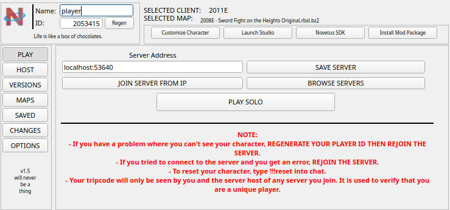

# Novetus Linux Port

> ⚠️ **AI-CODED SOFTWARE — READ BEFORE USE**
>
> This Linux port was written almost entirely by an AI coding agent.
> It has **not** been professionally reviewed or audited. Use at your own
> risk: expect bugs, incomplete edge cases, and non-idiomatic code.
> Read the source before running anything, especially the networking
> components (web proxy, UPnP, server browser). Not affiliated with or
> endorsed by the Novetus or Roblox projects.

A native Linux port of the [Novetus](https://github.com/RocketClocks/Novetus)
Roblox client launcher — a ground-up C++17/Qt6 rewrite with no .NET runtime,
running the original Roblox clients through Wine.

---

## Quick start

```bash
# 1. Install dependencies (Debian/Ubuntu)
sudo apt install build-essential cmake qt6-base-dev qt6-declarative-dev \
                 libqt6network6 libqt6xml6 libssl-dev \
                 wine unzip zip bzip2

# 2. Build
cd linux-port/native
cmake -B build -DCMAKE_BUILD_TYPE=Release
cmake --build build -j$(nproc)
cp build/novetus-native build/novetus-qt ../../data/bin/

# 3. Run (from the data folder)
cd ../../data/bin
./novetus-qt
```

Wine with the Roblox clients installed in a Wine prefix is required to
actually play. Roblox Player/Studio can be installed into a prefix with the
`wine-roblox-*.sh` helper scripts at the repository root.

## Binaries

| Binary | Description |
|---|---|
| `novetus-qt` | The GUI launcher (Extended / Compact / Stylish styles) |
| `novetus-native` | Headless CLI launcher — same core, no GUI |

```
./novetus-qt --console                       # open the command console
./novetus-qt --browser                       # open the server browser
./novetus-qt --settings                      # open the settings window
./novetus-qt --launcher-style compact        # force a launcher style

./novetus-native --list                      # list installed clients
./novetus-native --type solo                 # play solo
./novetus-native --type server --map Crossroads.bz2
./novetus-native --type studio
./novetus-native --type client --client 2011M
```

## Wine configuration

By default the launcher resolves the Wine prefix as
`$NOVETUS_WINEPREFIX` → `~/.novetus/windows_prefix` → `~/.wine`, and starts
clients with the `wine` command.

Both can be overridden in the launcher's **OPTIONS** tab:

- **Wine Command** — the exact command used to start Wine (blank = `wine`).
  Values with spaces are split into program + arguments, so wrappers like
  `gamescope -- wine` work too.
- **Wine Prefix** — the `WINEPREFIX` used for all launches, with a folder
  picker (blank = the default resolution above).

Both are saved to `data/config/config.json` and apply from the next launch.

## Screenshots



## Features

- **All three original launcher styles** — Extended, Compact and Stylish,
  rebuilt to match the original layouts: play solo, join by IP, save/browse
  servers, host, client selection, map management, saved servers,
  changelog, and options
- **Character Customization** — full 1:1 rebuild: body colors and presets,
  hats/heads/faces/shirts/pants/extra with previews and descriptions,
  custom-ID items via all nine content providers, BC/TBC/OBC icons, custom
  and online icons, appearance URL, outfit save/load
- **Graphics settings** — graphics mode and quality presets, plus a custom
  options dialog (quality level, mesh/shading quality, anti-aliasing,
  shadows, bevels, resolutions, early-2007 window styles) that edits the
  selected client's settings directly
- **Server browser** with the original server/port lists
- **Console** with ~35 commands (type `help`): launch modes, settings,
  networking, proxy/UPnP control, extensions and more
- **SDK** with nine tools: Clientinfo Editor, Asset Fixer, Asset Downloader,
  Mesh Converter, Item SDK, Mod Creator, Client Script Documentation,
  Splash Tester and Diogenes Editor
- **Mod support** — install `.zip`/`.novmod` packages or addon scripts,
  and create your own packages
- **Web Proxy** (port 6171) — local HTTP proxy for Roblox traffic, scriptable
  with JavaScript extensions in `data/extensions/webproxy/`
- **UPnP** — automatic UDP/TCP port forwarding when hosting (optional)
- **Discord Rich Presence** — direct IPC, no external libraries
- **3D avatar preview** via the Outfit View launch mode

## Project layout

```
linux-port/
├── native/                # the C++ port (CMake + Qt6)
│   ├── CMakeLists.txt
│   └── src/
│       ├── core/          # launcher core (no GUI)
│       ├── gui/           # Qt6 windows
│       ├── cli/           # novetus-native entry point
│       └── gui_assets/    # embedded images
└── README.md

*Note: the original C# sources used as a development reference are not part
of this repository — only the C++ port is.*
```

## Data files of note

| File | Purpose |
|---|---|
| `data/config/config.json` | launcher settings |
| `data/config/config_customization.json` | avatar loadout |
| `data/config/clients/*.xml` | per-client graphics templates |
| `data/shareddata/charcustom/` | customization items (hats, faces, ...) |
| `data/shareddata/charcustom/custom/icons/` | custom player icons |
| `data/extensions/webproxy/` | web-proxy JavaScript extensions |
| `data/addons/` | addon scripts (`AddonLoader.lua`) |
| `data/config/itemtemplates/` | Item SDK templates |
| `data/config/splashes.txt` | splash texts |

## Known limitations

- Master-server announcement (UDP ping) is not implemented — hosted servers
  are reachable on LAN / direct IP only
- RSA join-script signing is not implemented; clients that require it
  (`%signgeneratedjoinscript%`) will not work
- The web proxy relays HTTPS traffic without decryption, so it cannot rewrite
  TLS-encrypted asset requests (plain HTTP interception works fully)
- Launcher auto-update / bootstrap flows are not ported

## Troubleshooting

- **Client won't start** — verify Wine works (`wine --version`) and that the
  Roblox client is installed inside the Wine prefix
- **Server not reachable from outside** — forward the Roblox port (default
  53640) as **UDP** in your router, or enable UPnP in the HOST tab
- **Black character in-game** — press **Regen** next to your Player ID and
  rejoin (see the launcher's NOTE text)
- **Proxy-related network issues** — turn the web proxy off in the OPTIONS
  tab, or run `proxy off` in the console

---

*Novetus is a multi-version ROBLOX client launcher — the original project
lives at [github.com/Novetus](https://github.com/Novetus), with its source at
[github.com/Novetus/Novetus_src](https://github.com/Novetus/Novetus_src).
This Linux port is an independent project: it is not made by, endorsed by, or
affiliated with the Novetus contributors or community.*
